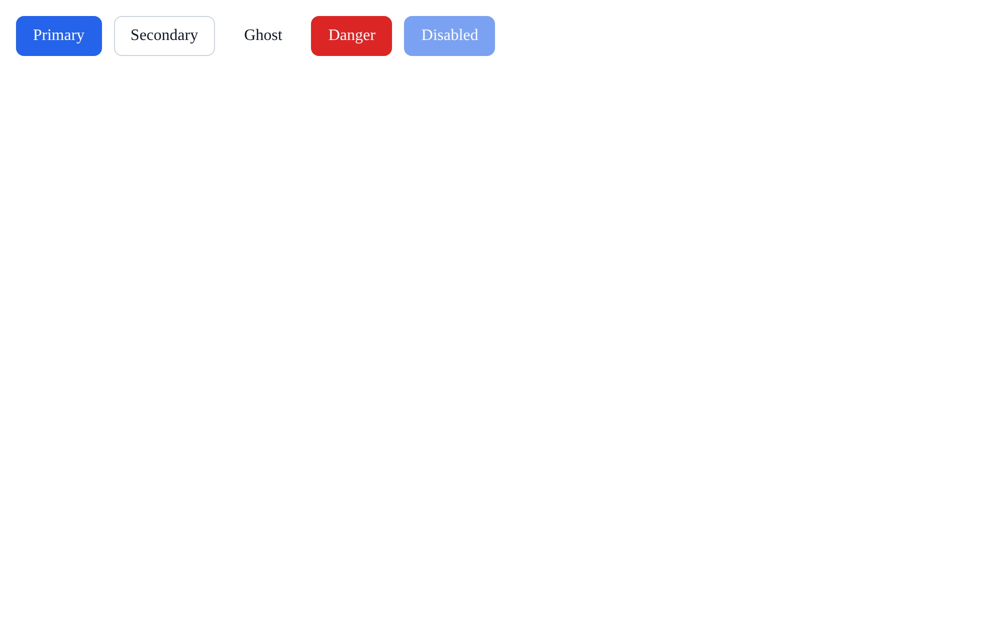

# @smrafi/ui — Angular component library

[](https://github.com/smrafi4130/angular-ui-kit/actions/workflows/ci.yml)

An accessible, token-driven Angular 19 component library: **standalone components**, built on **Angular CDK** for overlay/focus behaviour, documented in **Storybook**, packaged with **ng-packagr**, with **light/dark theming** via CSS custom properties.



## Components
| Component | Notes |
|---|---|
| `UiButton` (`button[uiButton]`, `a[uiButton]`) | Attribute selector on a native element, so type/disabled/focus/keyboard come from the platform; variants, sizes and an accessible loading state (`aria-busy` + spinner) layered on via host bindings. |
| `UiTag` (`ui-tag`) | Status/label pill with tones. |
| `UiFormField` (`ui-form-field`) + `UiControl` (`[uiControl]`) | Wires label, hint and error to the projected control with generated ids and `aria-describedby` / `aria-invalid`, re-synced reactively with a signal `contentChild` query. |
| `UiTabs` (`ui-tabs`) + `UiTab` (`ui-tab`) | WAI-ARIA tabs: roving tabindex, arrow/Home/End navigation skipping disabled tabs, `aria-controls`/`aria-labelledby`, two-way `active` model; inactive panels aren't rendered. |
| `UiDialogService` | Thin wrapper over `@angular/cdk/dialog` with house defaults (focus trap, focus restore, Escape, `aria-modal`, `role="alertdialog"` for destructive confirms). |

## Design decisions
- **Standalone, OnPush, signals.** Components are standalone with `ChangeDetectionStrategy.OnPush`; inputs are signal inputs; derived host classes use `computed`.
- **Native elements over re-implementations.** `UiButton` decorates a real `<button>`/`<a>`; `UiFormField` wraps the consumer's own control rather than owning it.
- **CDK for the hard parts.** The accessible overlay (focus management, scroll blocking, aria) is Angular CDK; the library adds consistent defaults rather than re-building it.
- **Tokens, two tiers of theming.** All visual values are CSS custom properties in `styles/tokens.scss`; `[data-theme="dark"]` remaps them, so dark mode touched no component code.

## Use it
```bash
pnpm install
pnpm storybook            # component docs & playground
pnpm lint
pnpm test:ci              # headless Chrome (set CHROME_BIN if needed)
pnpm build:lib            # ng-packagr -> dist/ui (publishable @smrafi/ui)
pnpm build-storybook
```
In an app:
```ts
import { UiButton, UiDialogService } from '@smrafi/ui';
// import the theme once, e.g. in styles.scss:
// @use '@smrafi/ui/.../tokens';  (or the compiled tokens.css)
```

## Testing
Karma + Jasmine, headless Chromium (6 tests): button classes + loading aria; tag tone; **form-field label/hint/error aria wiring** (the a11y contract); dialog opens with `role`/`aria-modal`/`aria-label` and closes. Storybook runs the a11y addon with `test: 'error'`, covering colour contrast that jsdom-less unit tests can't.

## Trade-offs and limitations
- **Four components, not a full kit** — enough to show the patterns (attribute-selector components, content projection with aria wiring, CDK overlays, theming) without padding. No Select/Menu yet.
- Theme tokens are shipped as SCSS/CSS; a Figma-tokens pipeline would be the next step.
- Not published to npm yet; `pnpm build:lib` produces the publishable package in `dist/ui`.
- Visual regression (Playwright/Chromatic) is a planned addition; today Storybook's a11y addon is the automated visual-quality gate.

## License
MIT
